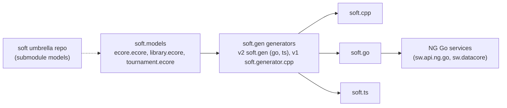
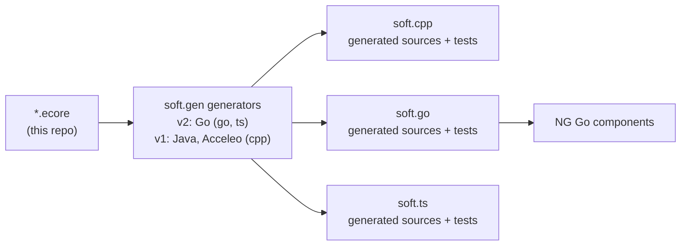

<!--
sword:
  schema: 1
  name: soft.models
  family: ecore-esync
  kind: ecore-model
  generation: shared
  shipped: false # UNVERIFIED
  languages: [XML, Ecore]
  build: [none]
  ng: [ecore-model]
  apps: []
-->

# soft.models

> Ecore meta-models (`.ecore` XMI files) that the SOFT code generators consume to produce the `soft.cpp`, `soft.go` and `soft.ts` Ecore runtime libraries and their tests; data only, no executable code.

| | |
|---|---|
| **Family** | Ecore / esync |
| **Kind** | ecore model |
| **Languages** | XML (Ecore/XMI), Eclipse launch XML. No Go, C++, TypeScript or Python source. |
| **Remote / branch** | github.com/masagroup/soft.models, default branch `master` |
| **Generation** | shared |
| **Build systems** | None (no `build.xml`, Dockerfile, CMake, `go.mod`, Makefile or `package.json`) |

## Overview

`soft.models` holds the input models of the SOFT generator chain (`soft.gen`). Its main file, `ecore.ecore`, is the SOFT port of the Eclipse EMF Ecore meta-model, annotated with per-language generator hints (C++, Go, TypeScript). Running the generators on it produces the Ecore runtime itself in the three languages (`soft.cpp`, `soft.go`, `soft.ts`). The repository also ships sample models (`library`, `tournament`, `empty`) used to generate tests and examples.

The repository contains no service and speaks no protocol. Its only "clients" are the generators and the CI of the runtime repositories, which use it through a pinned-commit CI checkout, a local path or a git submodule.

NG-specific models (`physical`, `simulation`) are NOT here: they live in `sw/sw.api.ng/ecore/` (see [sw.api.ng](https://github.com/masagroup/sw.api.ng)). The NG link is indirect: NG Go services depend on `soft.go`, which is generated from `ecore.ecore`.



## Repository layout

The repository root is flat: no subdirectories, no `.github`, no README, no LICENSE.

```
soft.models/
  ecore.ecore                            # SOFT Ecore meta-model with generator annotations (1048 lines)
  library.ecore                          # EMF "library" example model (198 lines)
  tournament.ecore                       # tournament example model with eOpposite (42 lines)
  empty.ecore                            # empty package `empty`, nsURI `empty` (3 lines)
  generate.ecore.{cpp,go,ts}.launch      # Eclipse run configurations: regenerate the Ecore runtime
  generate.library.{cpp,go,ts}.launch    # Eclipse run configurations: library test/example model
  generate.tournament.go.launch          # Eclipse run configuration: tournament model (Go)
  generate.tournament-reflective.go.launch  # tournament with featureDelegation=Reflective (Go)
  .project                               # bare Eclipse project descriptor `soft.models`
```

## Build

There is nothing to build in this repository. The models are consumed by other repositories; the regeneration commands below are the real "build" of the data.

### Windows (Ant)

Not applicable to this repository. Upstream C++ regeneration is an Ant target in `soft.cpp/build.xml` (repository root, not `build/`; the umbrella copy is `soft/cpp/build.xml`) that wraps a `docker run` of the generator image with `models.dir` defaulting to `../models`:

```
docker run --rm -v '${root.dir}:/pwd' -v '${models.dir}:/models' -w /pwd masagroup/soft.generator.cpp -m /models/ecore.ecore -o /pwd -P /pwd/generator.properties -t generateModel -t generateLibraryCMakeSources -t generateTests -t generateTestsCMakeSources -t generateTestsCMakeDependencies
```

The same call is made with `-m /models/library.ecore -o /pwd -P /pwd/generator.properties` and no `-t`.

### Linux (Docker)

Not applicable to this repository. The consumers run the generators of [soft.gen](https://github.com/masagroup/soft.gen):

| Generator | Used by |
|---|---|
| soft.gen v2: the Go command `soft.gen` (`go`, `ts`), at the version `SOFT_GEN_VERSION` of each Makefile | `soft.go/Makefile`, `soft.ts/Makefile`; the `release/v2` branches of soft.sync.go and sw.api.ng.go |
| v1 image `masagroup/soft.generator.cpp` (Java, Acceleo), no tag | `soft.cpp/build.xml` |
| v1 image `masagroup/soft.generator.go` (Java, Acceleo), no tag | `sw.api.ng.go/generate.sh` and `soft.sync.go/Makefile` on their `master` |

soft.go and soft.ts no longer use the v1 images `masagroup/soft.generator.go|ts`: they generate with soft.gen v2 (`go run .../cmd/soft-gen@v2.0.0-alpha.2` until 2026-10-22, the image `masagroup/soft.gen:<SOFT_GEN_VERSION>` since). Their Makefiles read the models from a sibling `../models` checkout (mounted on `/models` when the generator runs in a container), so a local `make generate` expects one.

### Other

#### Local regeneration from Eclipse

The `generate.*.launch` files run the generator main classes from inside the `soft.gen` workspace, where `../../../models` resolves to this repository and `../../../cpp|go|ts` to the runtime repositories (umbrella `soft` layout). All use the Maven classpath provider (`org.eclipse.m2e.launchconfig.classpathProvider`), i.e. they assume the generators are Maven-built Java projects (`soft.gen` has a `pom.xml`, per the scan).

| Launch file | Main class | Program arguments |
|---|---|---|
| `generate.ecore.cpp.launch` | `soft.generator.cpp.Generate` | `-m ../../../models/ecore.ecore -o ../../../cpp -t generateModel -t generateLibraryCMakeSources -t generateTests -t generateTestsCMakeSources -t generateTestsCMakeDependencies` |
| `generate.ecore.go.launch` | `soft.generator.go.Generate` | `-m ../../../models/ecore.ecore -o ../../../go` |
| `generate.ecore.ts.launch` | `soft.generator.ts.Generate` | `-m ../../../models/ecore.ecore -o ../../../ts -P ../../../ts/generator.properties -t generateModel -t generateTests` |
| `generate.library.cpp.launch` | `soft.generator.cpp.Generate` | `-m ../../../models/library.ecore -o ../../../cpp` |
| `generate.library.go.launch` | `soft.generator.go.Generate` | `-m ../../../models/library.ecore -o ../../../go/test` |
| `generate.library.ts.launch` | `soft.generator.ts.Generate` | `-m ../../../models/library.ecore -o ../../../ts/examples -P ../../../ts/generator.properties -p accessors=property` |
| `generate.tournament.go.launch` | `soft.generator.go.Generate` | `-m ../../../models/tournament.ecore -o ../../../go/test` |
| `generate.tournament-reflective.go.launch` | `soft.generator.go.Generate` | `-m ../../../models/tournament.ecore -o ../../../go -P ../../../go/generator.properties -p featureDelegation=Reflective -p module=github.com/masagroup/soft.go -p packages=github.com/masagroup/soft.go/test/tournament-reflective/tournament#github.com/masagroup/soft.go/test/tournament-reflective/internal/impls/impls#github.com/masagroup/soft.go/test/tournament-reflective/internal/mocks/mocks` |

Generator CLI flags visible in these files: `-m` model, `-o` output directory, `-P` properties file, `-p key=value` single property, `-t` template/task (repeatable; the form `-t !name` is used in `soft/cpp/build.xml`). The `generate.ecore.ts.launch` configuration sets `STOP_IN_MAIN=true`.

## Run

Not applicable: this repository produces no executable, service, port, environment variable or runtime configuration.

## Dependencies

### Internal

The repository depends on no other MASA repository (no build file, no `.gitmodules`, no imports). It only references them symbolically, and is itself consumed by several.

Symbolic references from this repository:

| Reference | Where | Meaning |
|---|---|---|
| `github.com/masagroup/soft.go/ecore/ecore.CompactEObjectContainer` | `ecore.ecore`, GenGo package annotation `rootExtendsClass` | Go root class extended by the generated Ecore Go objects; points into [soft.go](https://github.com/masagroup/soft.go) |
| `module=github.com/masagroup/soft.go` and `packages=...test/tournament-reflective/...` | `generate.tournament-reflective.go.launch` | Go module path of the generated tests in `soft.go` |
| `../../../cpp`, `../../../go`, `../../../ts` | launch files | Output directories: [soft.cpp](https://github.com/masagroup/soft.cpp), [soft.go](https://github.com/masagroup/soft.go), [soft.ts](https://github.com/masagroup/soft.ts) |
| `soft.generator.cpp`, `.go`, `.ts` | launch files | v1 generator projects (Java, Acceleo) of [soft.gen](https://github.com/masagroup/soft.gen), in its history up to the `v1.x` tags |

Reverse dependencies (who pulls this repository):

| Repository | How it is pulled | What for |
|---|---|---|
| [soft.cpp](https://github.com/masagroup/soft.cpp) | Local path `models.dir=../models` in `build.xml` (`docker run -v ${models.dir}:/models`) | Regenerate the C++ Ecore runtime and library tests |
| [soft.go](https://github.com/masagroup/soft.go) | CI checkout of `masagroup/soft.models` pinned at commit `90286c344159492747920472760ac3904b19e784` into `models/`; local `make generate` from `../models` | Regenerate the Go runtime and tests |
| [soft.ts](https://github.com/masagroup/soft.ts) | CI checkout pinned at `f0dd72e4ff1ff931f202c7464d30a15b4cf2102d` (current HEAD) into `models/`; local `make generate` from `../models` | Regenerate the TypeScript runtime and tests |
| [soft](https://github.com/masagroup/soft) (umbrella) | git submodule `models` -> `https://github.com/masagroup/soft.models.git` (next to `gen`, `cpp`, `go`, `ts`) | Aggregate checkout of the SOFT stack; its `models` copy is older than this repository (lacks `generate.tournament-reflective.go.launch`) |

The workspace helper scripts `update.sh`, `diff.sh` and `status.sh` of the `soft` umbrella workspace also list this repository. No NG repository references `soft.models` by name (text grep, may be incomplete on large trees).

### External

* Eclipse EMF Ecore: `ecore.ecore` reproduces the EMF Ecore meta-model (`nsURI="http://www.eclipse.org/emf/2002/Ecore"`, `nsPrefix="ecore"`). `instanceClassName` values are Java EMF classes (for example `org.eclipse.emf.ecore.resource.Resource`, `java.util.Map$Entry`).
* `library.ecore` (nsURI `http:///org/eclipse/emf/examples/library/library.ecore/1.0.0`) and `tournament.ecore` (nsURI `http://mattsch.com/emf/examples/tournament`) look derived from public EMF examples; origin inferred from the nsURI only.
* XML Schema types in `ExtendedMetaData` annotations (`http://www.w3.org/2001/XMLSchema#string`, etc.).
* No version is pinned in this repository.

## Architecture

### Models

| File | Package / nsURI | Content |
|---|---|---|
| `ecore.ecore` | `ecore`, `http://www.eclipse.org/emf/2002/Ecore` | 20 EClasses, 33 EDataTypes, 37 EOperations (counts by grep) |
| `library.ecore` | `library` (prefix `lib`) | Book, BookIndex (renamed from Index; map entry), Library, Writer, Item, Lendable, CirculatingItem, Periodical, AudioVisualItem, BookOnTape, VideoCassette, Borrower, Person, Employee, Addressable, DocumentRoot; enum BookCategory |
| `tournament.ecore` | `tournament`, `http://mattsch.com/emf/examples/tournament` | Tournament, NamedElement (abstract), Group, Team, Match; enum MatchKind; bidirectional Group.teams / Team.group |
| `empty.ecore` | `empty`, nsURI `empty` | Empty package; no launch configuration references it |

**`ecore.ecore`**

* EClasses: EAttribute, EAnnotation, EClass, EClassifier, EDataType, EEnum, EEnumLiteral, EFactory, EModelElement, ENamedElement, EObject, EOperation, EPackage, EParameter, EReference, EStructuralFeature, ETypedElement, EStringToStringMapEntry, EGenericType, ETypeParameter.
* EDataTypes: the usual EMF primitives and wrappers (EBoolean, EInt, ELong, EString, EDate, EBigInteger, EBigDecimal, ...) plus EEList, EMap, EFeatureMap, EResource, EResourceSet, ETreeIterator, EDiagnosticChain, EJavaClass, EJavaObject, EInvocationTargetException, EEnumerator, etc.
* Package-level annotations (lines 4-16): GenCpp `factory=extension`, `lazy=list:function`; GenGo `lazy=list:function`, `rootExtendsClass=github.com/masagroup/soft.go/ecore/ecore.CompactEObjectContainer`, `exported=true`; GenTS `lazy=list:function`.
* The model drives generation of the Ecore runtime itself in the three languages: generated base classes plus hand-written "extension" implementations (`extension=true` appears 36 times across the three generators).
* TypeScript-specific: `async=true` on two eGet operations (lines ~556 and ~572) and `operationName=eGetResolve`.
* C++-specific: `instanceTypeName` (for example `std::string`, `std::shared_ptr<ecore::EResource>`) and `include` headers per datatype.

**`library.ecore`** uses containment, eOpposite, `ExtendedMetaData` and unsettable features. GenGo/GenTS `supressAnnotations` (spelling as in the file) hides the other generators' annotations. It generates tests and examples (`go/test`, `ts/examples`, C++).

**`tournament.ecore`** generates Go tests, including the "reflective" variant (`featureDelegation=Reflective`).

### Annotation conventions (generator extension points)

Annotation sources used in `ecore.ecore` (occurrence counts):

| Source URI | Occurrences |
|---|---|
| `http://net.masagroup/soft/2018/GenCpp` | 75 |
| `http://net.masagroup/soft/2019/GenGo` | 47 |
| `http://net.masagroup/soft/2020/GenTS` | 45 |

Standard `http://www.eclipse.org/emf/2002/Ecore` (constraints) and `http:///org/eclipse/emf/ecore/util/ExtendedMetaData` annotations are also used.

Detail keys in `ecore.ecore` (counts): `lazy` 42, `extension` 36, `default` 30, `instanceTypeName` 27, `const` 27, `baseType` 19, `visibility` 15, `constraints` 12, `operationName` 8, `name` 8, `include` 7, `exported` 5, `unsetVisibility` / `setVisibility` / `issetVisibility` 3 each, `async` 2, `rootExtendsClass` 1, `factory` 1. In `library.ecore`: `supressAnnotations`.

### Data flow



`*.ecore` -> generators of `soft.gen` (v2, Go: `soft.gen go` and `soft.gen ts` for soft.go and soft.ts; v1, Java and Acceleo: the image `masagroup/soft.generator.cpp` for soft.cpp) -> sources written into `soft.cpp` / `soft.go` / `soft.ts` and their tests or examples. Those runtime libraries provide Ecore objects to downstream C++, Go and TypeScript components. See the ecosystem wiki page "esync and ecore" for the full model/esync picture.

## CI/CD

* No `.github/` directory: no workflows, no artifacts, no releases built here.
* Versioning is by git commit: `soft.go` and `soft.ts` pin a commit SHA in their CI workflows (`.github/workflows/build_and_test.yaml`); `soft.cpp` and the `soft` umbrella use a local path / submodule. A change here only takes effect in a consumer's CI after a SHA bump in that consumer's workflow.
* Observed pins: `soft.go` at `90286c3...` (merge of PR #22 `rename.library.index`, 9 commits behind HEAD, missing PRs #23, #24, #25); `soft.ts` at `f0dd72e...` (= HEAD).
* Tags: 9 local tags `v1.1.0` to `v1.8.0`; latest `v1.8.0` = `91fcdc5` (2023-09-22), 15 commits behind HEAD. HEAD `f0dd72e` (merge of PR #25 `ecore.factory`, 2024-09-19) is untagged.
* General pipeline documentation: [cicd](https://github.com/masagroup/cicd) and the ecosystem wiki page "CI/CD pipelines".

## Next-gen relevance

| Component | Relation |
|---|---|
| ecore model | Implements the Ecore meta-model itself in SOFT form. NG-specific models are not here: they live in `sw/sw.api.ng/ecore/` ([sw.api.ng](https://github.com/masagroup/sw.api.ng), generated Go code in [sw.api.ng.go](https://github.com/masagroup/sw.api.ng.go)). |
| esync | Not implemented here. Indirect: [soft.sync.go](https://github.com/masagroup/soft.sync.go) (esync, v1 and v2 protocol in [soft.sync.pb](https://github.com/masagroup/soft.sync.pb)) builds on `soft.go` (`soft.sync.go/go.mod` requires `soft.go v1.11.0`), itself generated from `ecore.ecore`. |
| datacore | Indirect consumer of `soft.go` ([sw.datacore](https://github.com/masagroup/sw.datacore); `sw/sw.datacore/go.mod` requires `soft.go v1.10.2`). `sw/sw.api.ng.go/go.mod` requires the same version. |
| gateway, history, dos, storage, authentication, node, orchestrator, commander, hub, recorder, timeline, mapserver, webclient, dispatcher, HLA | Unrelated (no mention in the repository files). |

`sw/sw.api.ng.go/generate.sh` runs the `masagroup/soft.generator.go` image on `modules/sw.api.ng/ecore/physical/*.ecore`. The repository is a foundation-level design-time dependency (through `soft.go`, `soft.ts`, `soft.cpp`), not an NG component. See the ecosystem wiki page "Next generation ecosystem".

## Known issues

No audit is mentioned in the scan report (UNVERIFIED whether one exists). Documentation defects reported by the scan:

* There is no README, LICENSE or other documentation; the launch files are the only documentation.
* All launch files hard-code relative paths `../../../models` and `../../../cpp|go|ts`, assuming the `soft` umbrella layout (generator project under `gen/`, sibling `models/`, `cpp/`, `go/`, `ts/`), not the flat `soft.*` layout of the workspace. Possibly outdated; not verified by running.
* Inconsistencies between launch files: `generate.ecore.go.launch` and `generate.library.go.launch` pass no `-P generator.properties` while the tournament-reflective one does; `generate.library.cpp.launch` has no `-t` filter while `generate.ecore.cpp.launch` lists tasks.
* `soft/cpp/build.xml` (umbrella submodule copy) uses `-t !generateLibraryCMakeProject -t !generateTestsCMakeProject`, an older form than `soft.cpp/build.xml` and the launch file.

## Open questions

* UNVERIFIED: generator CLI semantics and supported property keys (`accessors`, `featureDelegation`, `packages`, ...); they live in `soft.gen`, not analysed.
* UNVERIFIED: whether any NG repository consumes `soft.models` directly (none found by text grep).
* UNVERIFIED: purpose of `empty.ecore`.
* UNVERIFIED: which remote is canonical; consumer CI uses `masagroup/soft.models`.
* UNVERIFIED: whether the `soft.go` CI pin behind HEAD is intentional.
* UNVERIFIED: meaning and dating of the annotation-source year suffixes (2018/2019/2020).
* UNVERIFIED: origin of `library.ecore` and `tournament.ecore` (inferred from nsURI only).
